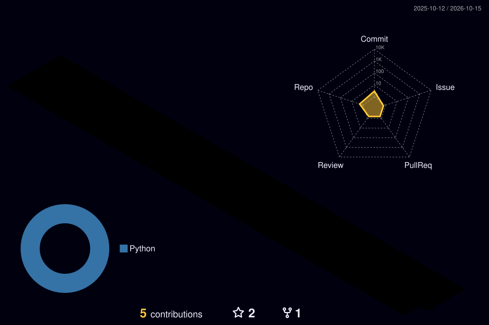

<!-- Animated header -->

  

  

  
  

---

## 👨‍💻 About Me

- 🚀 Full Stack Developer building backends, REST & GraphQL APIs and mobile apps
- 🐍 Most of my backend work is in **Python / Django** — auth (JWT), food-delivery and appointment-booking platforms
- 📱 Front end and mobile with **JavaScript** and **React Native**
- 🌱 Always learning: system design, cloud deployments and clean architecture
- 🤝 Open to collaborating on backend, API and full-stack projects
- 📫 Reach me via [GitHub](https://github.com/sachusudevan)

---

## 🛠️ Tech Stack

  

---

## 🧊 3D Contribution Graph

  

---

## 📊 GitHub Stats

  
  

  

---

## 🐍 Contribution Snake

  <picture>
    <source media="(prefers-color-scheme: dark)" srcset="https://raw.githubusercontent.com/sachusudevan/sachusudevan/output/github-contribution-grid-snake-dark.svg" />
    <source media="(prefers-color-scheme: light)" srcset="https://raw.githubusercontent.com/sachusudevan/sachusudevan/output/github-contribution-grid-snake.svg" />
    
  </picture>

<!-- Animated footer -->

  

