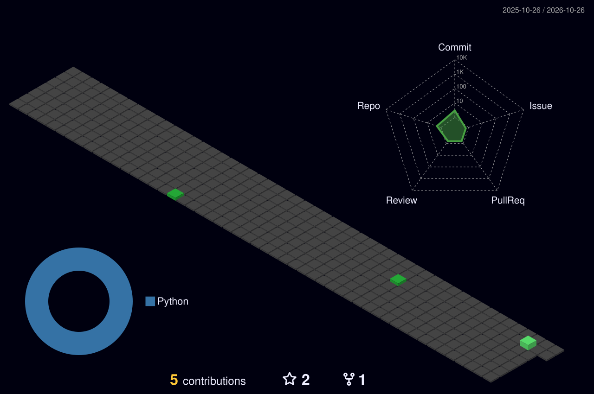

<!-- Header: binary-art avatar + terminal. Regenerate with: python3 scripts/build_header.py <photo> -->
<p align="center">
  
</p>

<p align="center">
  <a href="https://github.com/sachusudevan?tab=followers"></a>
  <a href="https://github.com/sachusudevan?tab=repositories"></a>
</p>

### `~/sachusudevan $ cat about_me.py`

```python
class SachuS(FullStackDeveloper):
    """Builds backends, APIs and the apps that use them."""

    def __init__(self):
        self.name = "Sachu S"
        self.github = "@sachusudevan"
        self.role = "Full Stack Developer"
        self.stack = {
            "backend":   ["Python", "Django", "GraphQL", "REST APIs", "JWT Auth"],
            "frontend":  ["JavaScript", "React"],
            "mobile":    ["React Native"],
            "databases": ["PostgreSQL", "MySQL"],
            "tools":     ["Git", "Docker", "Linux"],
        }
        self.projects = [
            "GraphQL JWT Authentication (Django)",
            "Food Delivery App — Backend & API",
            "Doctors Appointment Booking — Backend",
        ]
        self.learning = ["System Design", "Cloud Deployments", "Clean Architecture"]

    def say_hi(self) -> str:
        return "Thanks for stopping by! Let's build something together 🚀"


if __name__ == "__main__":
    print(SachuS().say_hi())
```

### `~/sachusudevan $ ls ./tech-stack`

<p align="center">
  <a href="https://skillicons.dev">
    
  </a>
</p>

### `~/sachusudevan $ git log --graph --3d`

<p align="center">
  
</p>

### `~/sachusudevan $ git stats --all`

<p align="center">
  
  
</p>

<p align="center">
  
</p>

### `~/sachusudevan $ ./snake --eat contributions`

<p align="center">
  <picture>
    <source media="(prefers-color-scheme: dark)" srcset="https://raw.githubusercontent.com/sachusudevan/sachusudevan/output/github-contribution-grid-snake-dark.svg" />
    <source media="(prefers-color-scheme: light)" srcset="https://raw.githubusercontent.com/sachusudevan/sachusudevan/output/github-contribution-grid-snake.svg" />
    
  </picture>
</p>

```bash
$ exit 0   # 01010100 01101000 01100001 01101110 01101011 01110011  →  "Thanks" for visiting 👋
```
